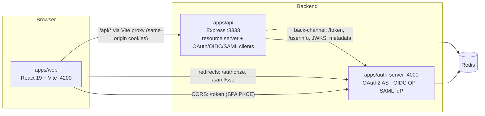

# 🔐 AuthLab – 9 authentication & authorization methods, end to end

An **Nx monorepo** where every method actually runs: a React 19 UI, a Node.js/Express API, a self-built
OAuth 2.0 Authorization Server / OpenID Provider / SAML IdP, and Redis behind them. Passwords are hashed with bcrypt.

| # | Method | Kind | Where it lives |
|---|--------|------|----------------|
| 1 | Basic Authentication | HTTP auth scheme | `apps/api/src/modules/basic.ts` |
| 2 | Digest Authentication | HTTP auth scheme | `apps/api/src/modules/digest.ts` |
| 3 | API Keys | Credential | `apps/api/src/modules/api-keys.ts` |
| 4 | Session-Based Auth | Stateful auth | `apps/api/src/modules/session.ts` + `lib/session.ts` |
| 5 | Bearer Tokens & JWT | Token format | `apps/api/src/modules/jwt.ts` + `lib/local-jwt.ts` |
| 6 | Access & Refresh Tokens | Token strategy | `apps/api/src/modules/tokens.ts` |
| 7 | OAuth 2.0 | **Authorization framework** | AS: `apps/auth-server/src/oauth.ts` · RS: `apps/api/src/modules/oauth2.ts` |
| 8 | OpenID Connect | **Identity protocol** (on top of OAuth 2.0) | OP: `apps/auth-server/src/oauth.ts` · RP/BFF: `apps/api/src/modules/oidc.ts` |
| 9 | SAML 2.0 | **Identity protocol** (XML) | IdP: `apps/auth-server/src/saml.ts` · SP: `apps/api/src/modules/saml.ts` |

📖 **Every method with its sequence diagrams:** [`docs/AUTH-METHODS.md`](docs/AUTH-METHODS.md). The same diagrams render live in the web app.

## Architecture



### Why it's split this way
- **One API, one module per method.** Each method is a self-contained Express router, so you can compare them side by side. Methods 1–6 are things *your own* API does, so they belong together.
- **A separate `auth-server`.** OAuth 2.0, OIDC and SAML are *delegation and federation* protocols. They only make sense when the identity provider is a different party from the app. Running it as its own process (with its own signing keys) keeps the trust boundary realistic: the API trusts it only through JWKS and metadata.
- **`libs/core`** (users + bcrypt, Redis, RS256 keys, X.509 certs, config, logger) and **`libs/shared`** (the method catalog used by both the UI and `/api/meta`) are shared through Nx/TS path aliases.

```
authlab/
├─ apps/
│  ├─ web/            React 19 + Vite + react-router + mermaid
│  ├─ api/            Express 5: modules/{basic,digest,api-keys,session,jwt,tokens,oauth2,oidc,saml}.ts
│  └─ auth-server/    Express 5: oauth.ts (AS + OP), saml.ts (IdP), clients.ts, views.ts
├─ libs/
│  ├─ core/           config(zod) · redis · users(bcrypt) · keys(RS256/JWKS, X.509) · logger(pino) · http
│  └─ shared/         AUTH_METHODS catalog, demo users
├─ docs/AUTH-METHODS.md   generated, with every diagram
├─ tools/gen-docs.ts
├─ docker-compose.yml     Redis (+ RedisInsight via --profile tools)
└─ nx.json · tsconfig.base.json · package.json (npm workspaces)
```

## Run it

```bash
npm install
cp .env.example .env          # optional, defaults work locally
docker compose up -d redis    # or a local redis-server
npm run dev                   # nx run-many -t dev → web :4200, api :3333, auth-server :4000
```

Open **http://localhost:4200**. Demo users: `alice / Password123!` (admin) and `bob / Password123!` (user).

Other commands: `npm run build` (esbuild bundles + Vite build, Nx-cached), `npm run typecheck`, `npm run graph` (Nx project graph), `npm run docs`.

Want to look inside Redis? Run `docker compose --profile tools up -d` and open RedisInsight on :5540. You'll see keys such as
`sess:*`, `rt:*`, `rt:family:*`, `jwt:deny:*`, `apikey:*`, `digest:nonce:*`, `as:code:*`, `oauth:state:*`, `saml:req:*`, `rl:*`.

## Standard practices implemented

| Concern | How |
|---|---|
| Password storage | **bcrypt** cost 12; constant-time dummy compare for unknown users (no user enumeration by timing) |
| Brute force | `express-rate-limit` + **Redis store**: per-IP+username on logins, per-key quota for API keys, global limit |
| Sessions | `express-session` + **connect-redis**; `HttpOnly`, `SameSite=Lax`, `Secure` in prod; `regenerate()` on login (stops session fixation); sliding TTL |
| CSRF | Synchronizer token (`X-CSRF-Token`) on cookie-authenticated mutations; `SameSite=Strict` + required custom header on the refresh endpoint; OAuth `state` bound to a cookie |
| JWT | **RS256** with `kid` and a JWKS endpoint; algorithm pinned (blocks `alg:none` and HS/RS confusion); `iss`/`aud`/`exp` checked; `jti` **deny-list in Redis** for logout |
| Refresh tokens | Opaque, stored **hashed**, **rotated on every use**, **reuse detection revokes the whole family**, atomic Lua update |
| API keys | `ak_<prefix>_<secret>`, shown once, **SHA-256** stored, prefix lookup, scopes, revocation, per-key rate limit |
| Digest | SHA-256 preferred, nonces in Redis with TTL, strictly increasing nonce count (replay protection) |
| OAuth 2.0 | Auth Code + **PKCE (S256)** required for public clients, exact `redirect_uri` match, single-use 60 s codes (`GETDEL`), RFC 9207 `iss`, scopes enforced at the resource server, `at+jwt` typ, introspection and revocation, Client Credentials |
| OIDC | BFF pattern (tokens never reach the browser), `nonce`, `at_hash`, ID token checked against JWKS, `/userinfo`, discovery doc |
| SAML | Signed assertions verified with the IdP cert from metadata, XSD schema validation (protects against signature wrapping), Audience/Destination/time window, **one-time `InResponseTo`** (replay protection) |
| General | `helmet` (CSP with nonces on IdP pages), CORS allow-list, zod validation of env and bodies, pino logs with credentials redacted, constant-time comparisons, central error handler |

## Production notes
This is a learning lab. Before using any of it for real:
- Replace the in-memory user store (`libs/core/src/users.ts`) with a database (Postgres + Prisma, for example).
- Load keys and certs from a KMS or secret manager instead of `.keys/`, and rotate them by `kid`.
- Use a battle-tested IdP (Keycloak, Auth0, Entra ID, Okta) or `oidc-provider` instead of `auth-server`, which is written for teaching.
- Serve everything over HTTPS (`NODE_ENV=production` turns on `Secure` cookies and stops `debug_refresh_token` being sent back).
