# AuthLab – Authentication methods reference

> Generated by `npm run docs` from `apps/web/src/content.ts`. GitHub renders the Mermaid blocks.

## Overview

### System architecture (Nx monorepo)

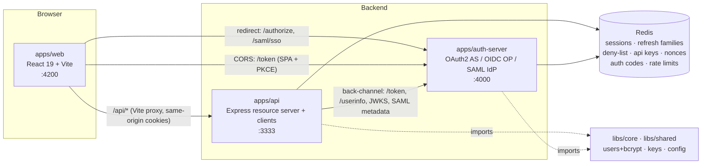

### Taxonomy – they are NOT all the same kind of thing

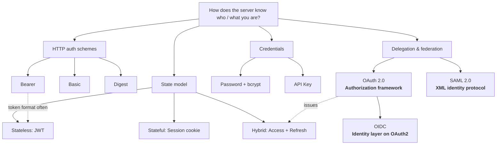

### Authentication vs Authorization

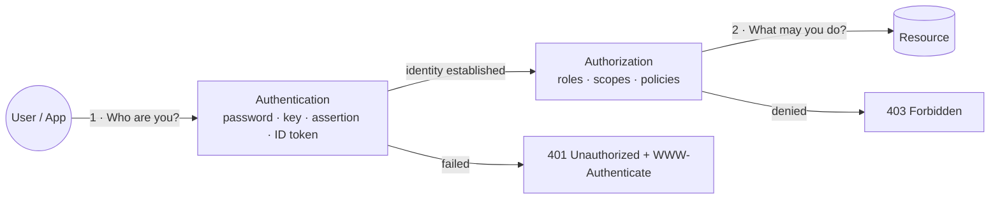

## Contents

1. [Basic Authentication](#basic) – *HTTP auth scheme*
2. [Digest Authentication](#digest) – *HTTP auth scheme*
3. [API Keys](#api-key) – *Credential*
4. [Session-Based Authentication](#session) – *Stateful auth*
5. [Bearer Tokens & JWT](#jwt) – *Token format*
6. [Access & Refresh Tokens](#tokens) – *Token strategy*
7. [OAuth 2.0](#oauth2) – *Authorization framework*
8. [OpenID Connect (OIDC)](#oidc) – *Identity protocol*
9. [SAML 2.0](#saml) – *Identity protocol*

<a id="basic"></a>
## 1. Basic Authentication

**Kind:** HTTP auth scheme · **Answers:** Authentication · **Stateless** · **API:** `/api/basic`

The client sends username:password, base64-encoded, in the Authorization header on every single request. Simple and universally supported, but the password is effectively sent in clear text, so TLS is mandatory.

| Credential travels as | Best for | Avoid when |
|---|---|---|
| `Authorization: Basic base64(user:pass) on EVERY request` | Internal tools, quick scripts, server-to-server over TLS | Public apps; no logout, password sent each call |

### Basic auth – challenge / response

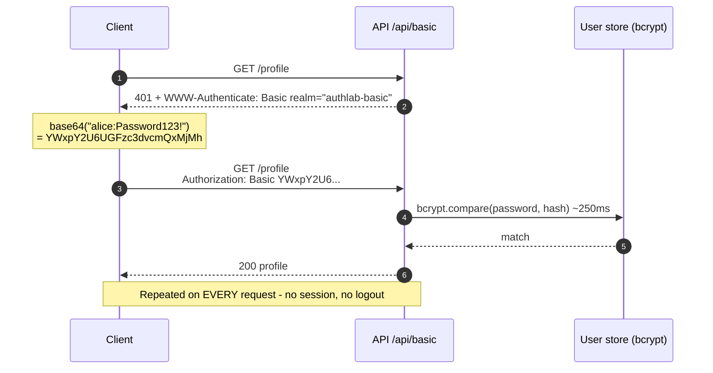

**Standard practices implemented**

- ✅ Always over HTTPS
- ✅ Verify with bcrypt + constant-time fallback hash for unknown users (no user enumeration)
- ✅ Rate-limit per IP+username
- ✅ Suppress browser popup for SPAs (x-Basic scheme trick)

**Pitfalls**

- ⚠️ Base64 is encoding, not encryption
- ⚠️ No logout / expiry
- ⚠️ bcrypt on every request is CPU-heavy
- ⚠️ Browsers cache credentials until closed

```bash
curl -u alice:Password123! http://localhost:3333/api/basic/profile
```

<a id="digest"></a>
## 2. Digest Authentication

**Kind:** HTTP auth scheme · **Answers:** Authentication · **Stateful** · **API:** `/api/digest`

A challenge-response scheme: the server sends a nonce, the client proves it knows the password by hashing it together with the nonce. The password never crosses the wire, but the server must store a password-equivalent hash (HA1), so bcrypt is impossible.

| Credential travels as | Best for | Avoid when |
|---|---|---|
| `Authorization: Digest username, nonce, response=H(HA1:nonce:nc:cnonce:qop:HA2)` | Legacy devices (IP cameras, routers, SIP) without TLS | Anything modern – server must store password-equivalent HA1 |

### Digest auth (RFC 7616, qop=auth)

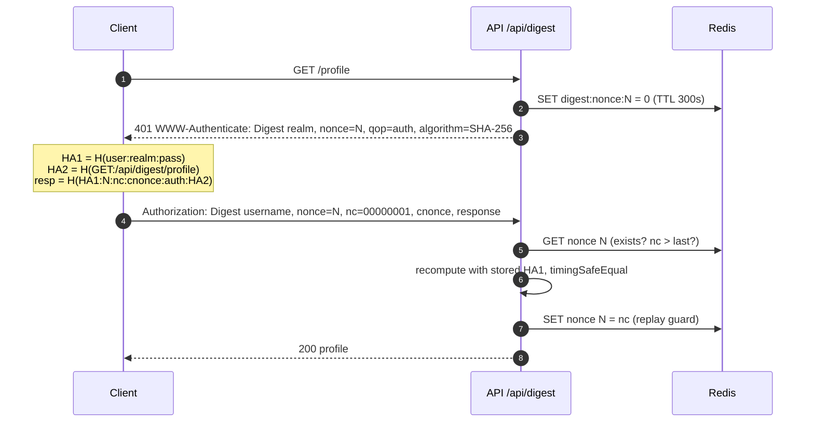

**Standard practices implemented**

- ✅ Prefer SHA-256 over MD5
- ✅ Short-lived nonces in Redis
- ✅ Strictly increasing nonce-count to block replay
- ✅ Constant-time comparison

**Pitfalls**

- ⚠️ Server stores HA1 = password-equivalent (no bcrypt)
- ⚠️ MD5 is broken
- ⚠️ Complex, poorly supported by modern clients
- ⚠️ Still vulnerable to MITM without TLS

```bash
curl --digest -u alice:Password123! http://localhost:3333/api/digest/profile
```

<a id="api-key"></a>
## 3. API Keys

**Kind:** Credential · **Answers:** Authentication · **Stateful** · **API:** `/api/api-keys`

A long random secret identifying an application (not a person). Ideal for developer access, metering and rate limits. Shown once, stored only as a hash, scoped and revocable.

| Credential travels as | Best for | Avoid when |
|---|---|---|
| `X-API-Key: ak_<prefix>_<secret>` | Machine/developer access to public APIs, metering, rate limits | End-user login; keys identify an app, not a person |

### Issue & use an API key

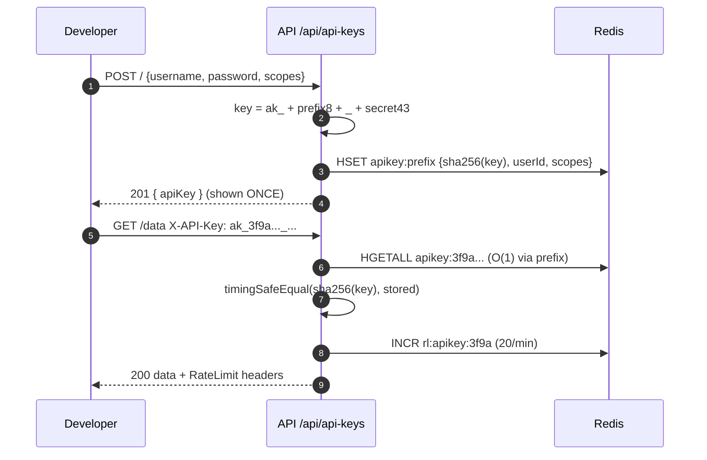

### Key anatomy

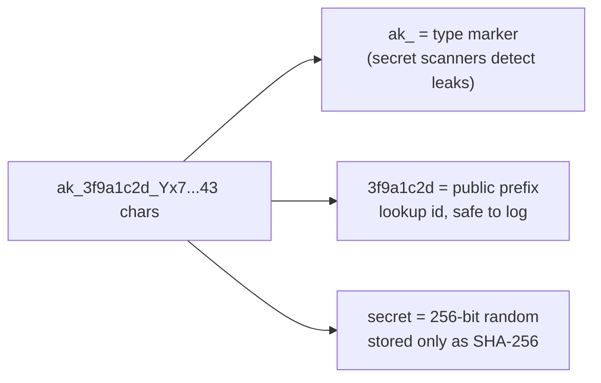

**Standard practices implemented**

- ✅ Hash keys (SHA-256 is fine – high entropy)
- ✅ Public prefix for lookup & display
- ✅ Per-key scopes + rate limit
- ✅ Send in header, never in URL (logs!)
- ✅ Rotation & revocation

**Pitfalls**

- ⚠️ Identifies the app, not the user
- ⚠️ Long-lived – leaks are common (Git, front-end bundles)
- ⚠️ Never embed in a browser/mobile app

```bash
curl -X POST localhost:3333/api/api-keys -H 'content-type: application/json' \
  -d '{"username":"alice","password":"Password123!","scopes":["data:read"]}'
curl localhost:3333/api/api-keys/data -H 'X-API-Key: ak_xxxxxxxx_...'
```

<a id="session"></a>
## 4. Session-Based Authentication

**Kind:** Stateful auth · **Answers:** Authentication · **Stateful** · **API:** `/api/session`

The server keeps the login state (in Redis) and gives the browser only an opaque, signed session-id cookie. Logout and revocation are instant because the server simply deletes the session.

| Credential travels as | Best for | Avoid when |
|---|---|---|
| `Cookie: sid=<opaque id> (HttpOnly, Secure, SameSite)` | Classic server-rendered / same-site web apps | Many independent APIs/mobile clients across domains |

### Session login with Redis store

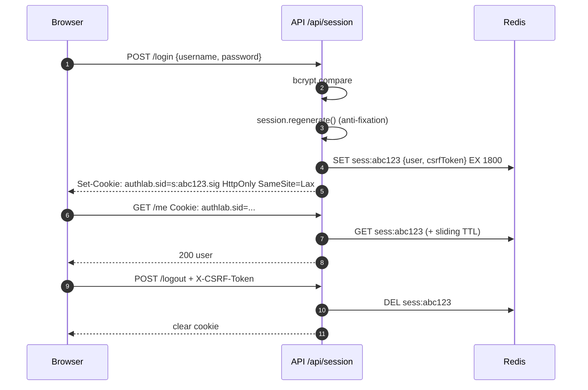

### Why the CSRF token?

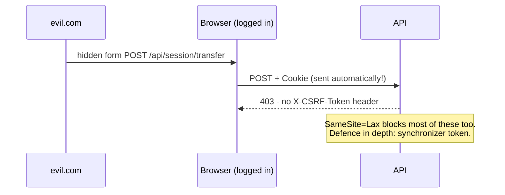

**Standard practices implemented**

- ✅ HttpOnly + Secure + SameSite cookie
- ✅ Regenerate id on login
- ✅ Server-side store (Redis) with TTL & sliding expiry
- ✅ CSRF token on state-changing requests
- ✅ saveUninitialized=false

**Pitfalls**

- ⚠️ Needs shared store for horizontal scaling
- ⚠️ Cookies are awkward for cross-domain APIs & native apps
- ⚠️ CSRF if SameSite misconfigured

```bash
curl -c jar -X POST localhost:3333/api/session/login -H 'content-type: application/json' \
  -d '{"username":"bob","password":"Password123!"}'
curl -b jar localhost:3333/api/session/me
```

<a id="jwt"></a>
## 5. Bearer Tokens & JWT

**Kind:** Token format · **Answers:** Authentication, Authorization · **Stateless** · **API:** `/api/jwt`

A Bearer token is any token where possession = access. JWT is a signed, self-contained token format: the API can verify it with a public key without any database lookup. Revocation needs extra work (a jti deny-list).

| Credential travels as | Best for | Avoid when |
|---|---|---|
| `Authorization: Bearer <header.payload.signature>` | Stateless APIs, microservices verifying with a public key | You need instant revocation without a deny-list |

### JWT structure

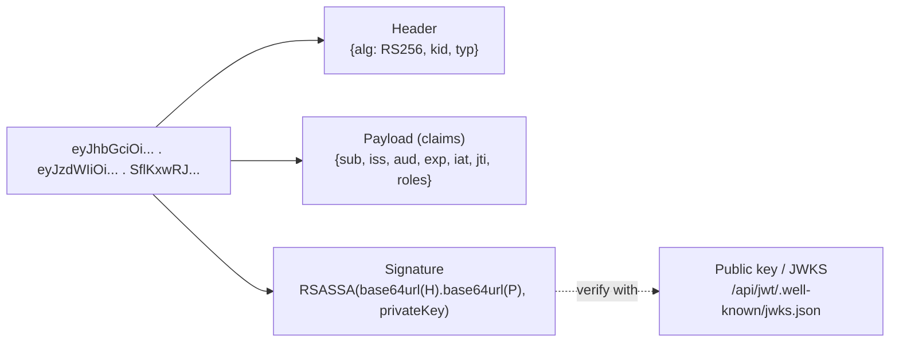

### Login, use, revoke

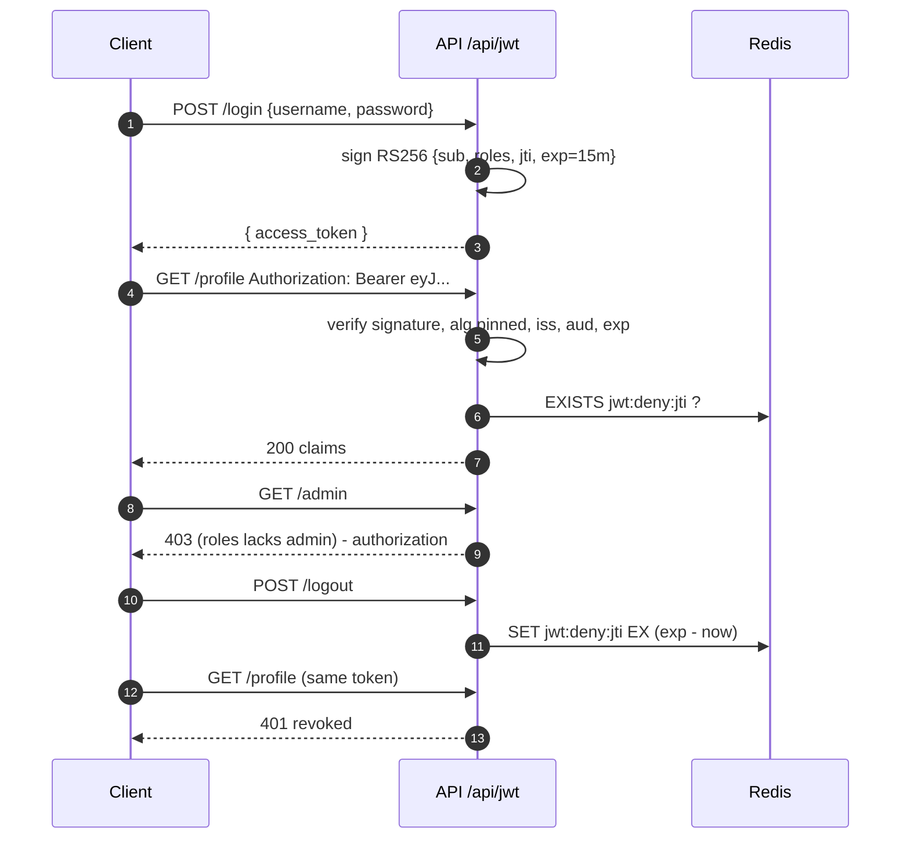

**Standard practices implemented**

- ✅ Asymmetric RS256/ES256 with kid + JWKS
- ✅ Pin allowed algorithms (block alg=none)
- ✅ Validate iss, aud, exp, nbf
- ✅ Short expiry, minimal claims (no secrets – payload is readable)
- ✅ Deny-list jti for logout

**Pitfalls**

- ⚠️ Cannot be revoked without state
- ⚠️ Storing in localStorage exposes it to XSS
- ⚠️ Big tokens on every request
- ⚠️ Never trust decoded claims without verifying

```bash
TOKEN=$(curl -s -X POST localhost:3333/api/jwt/login -H 'content-type: application/json' \
  -d '{"username":"alice","password":"Password123!"}' | jq -r .access_token)
curl localhost:3333/api/jwt/profile -H "Authorization: Bearer $TOKEN"
```

<a id="tokens"></a>
## 6. Access & Refresh Tokens

**Kind:** Token strategy · **Answers:** Authentication, Authorization · **Stateful** · **API:** `/api/tokens`

Short-lived access token (here 60 s, in memory) + long-lived refresh token (HttpOnly cookie). Each refresh rotates the refresh token; presenting an already-used one means theft, so the whole token family is revoked.

| Credential travels as | Best for | Avoid when |
|---|---|---|
| `Short-lived access token (memory) + rotating refresh token (HttpOnly cookie)` | SPAs/mobile needing long sessions with short-lived credentials | Simple same-site apps where a session cookie suffices |

### Rotation flow

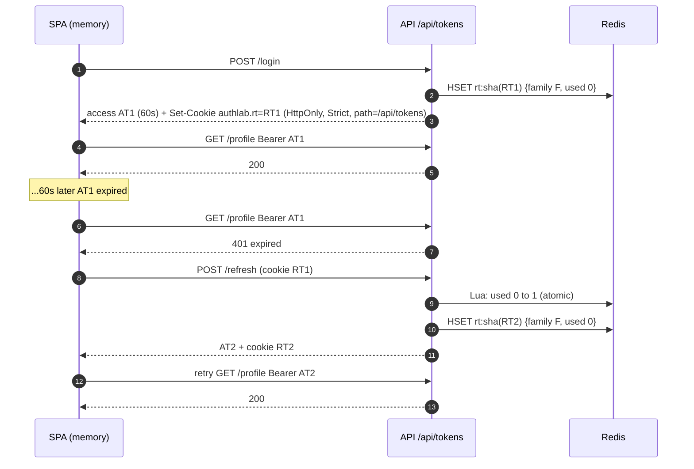

### Reuse detection

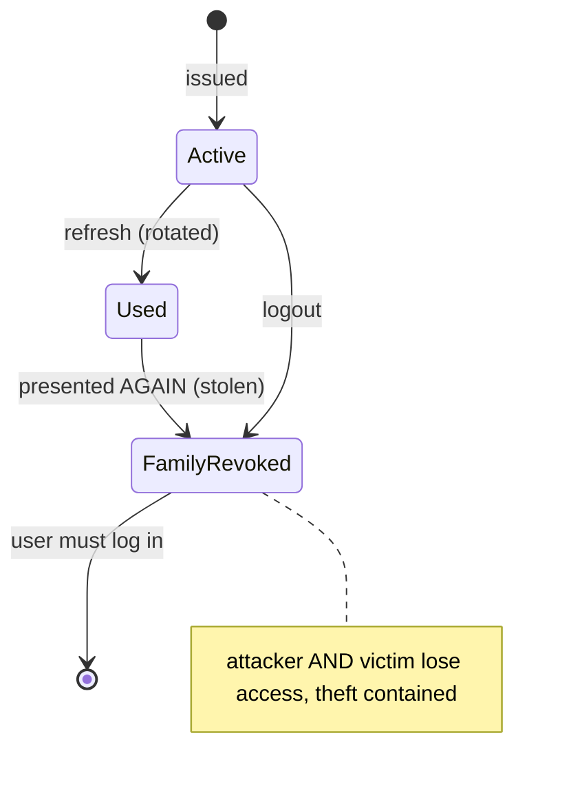

**Standard practices implemented**

- ✅ Access token short TTL, memory only
- ✅ Refresh token: HttpOnly, Secure, SameSite=Strict, narrow path
- ✅ Rotate on every use + reuse detection
- ✅ Store only hashed refresh tokens
- ✅ Atomic used-flag (Lua) to avoid races

**Pitfalls**

- ⚠️ Parallel tabs refreshing concurrently can trip reuse detection (use a refresh lock / grace window)
- ⚠️ Must handle 401 → refresh → retry in the client

```bash
curl -c jar -X POST localhost:3333/api/tokens/login -H 'content-type: application/json' \
  -d '{"username":"alice","password":"Password123!"}'
curl -b jar -c jar -X POST localhost:3333/api/tokens/refresh -H 'X-Requested-With: curl'
```

<a id="oauth2"></a>
## 7. OAuth 2.0

**Kind:** Authorization framework · **Answers:** Authorization · **Stateful** · **API:** `/api/oauth2`

OAuth 2.0 is an AUTHORIZATION framework: it lets a client app obtain a scoped access token to call an API on behalf of a user (Authorization Code + PKCE) or itself (Client Credentials) — without ever seeing the user's password. It says nothing standard about who the user is.

| Credential travels as | Best for | Avoid when |
|---|---|---|
| `Access token obtained via Authorization Code + PKCE (or Client Credentials)` | Delegated access: "let App X read my data at Service Y" | Using it alone as "login" – that is what OIDC is for |

### The four roles

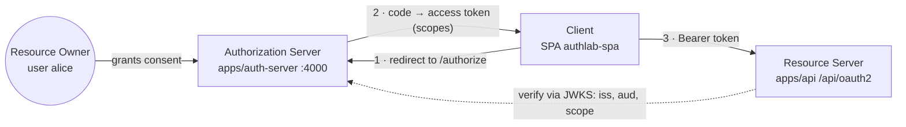

### Authorization Code + PKCE (public SPA client)

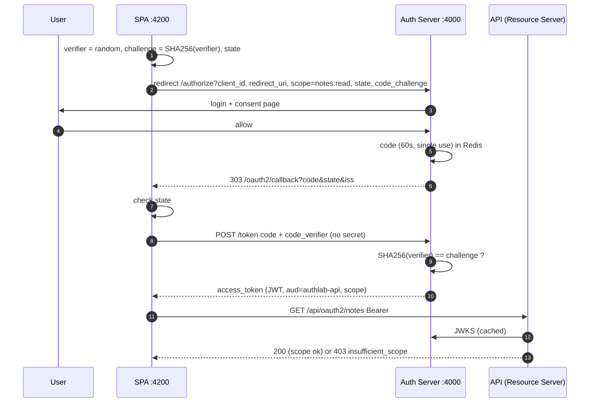

### Client Credentials (machine-to-machine)

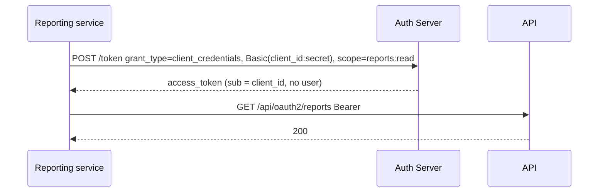

**Standard practices implemented**

- ✅ Authorization Code + PKCE for every client (OAuth 2.1)
- ✅ Exact redirect_uri matching
- ✅ state for CSRF, iss param against mix-up
- ✅ Short single-use codes
- ✅ Scopes = least privilege, enforced at RS
- ✅ Resource server validates aud

**Pitfalls**

- ⚠️ Implicit & password grants are deprecated
- ⚠️ An access token is NOT proof of login (use OIDC)
- ⚠️ Tokens in SPA memory still exposed to XSS – consider BFF

```bash
curl -X POST localhost:4000/token -u authlab-reporting-service:reporting-secret \
  -d grant_type=client_credentials -d scope=reports:read
```

<a id="oidc"></a>
## 8. OpenID Connect (OIDC)

**Kind:** Identity protocol · **Answers:** Authentication, Federation / SSO · **Stateful** · **API:** `/api/oidc`

OpenID Connect adds an identity layer on top of OAuth 2.0: the scope "openid" makes the provider return a signed ID Token (who the user is, when and how they logged in) plus a /userinfo endpoint and discovery. Here the API is a BFF: tokens stay server-side, the browser only gets a session cookie.

| Credential travels as | Best for | Avoid when |
|---|---|---|
| `ID Token (JWT) + access token from the OpenID Provider` | "Sign in with Google/Okta/Azure AD", modern SSO | Never really – it is the modern default for federated login |

### OIDC = OAuth 2.0 + identity

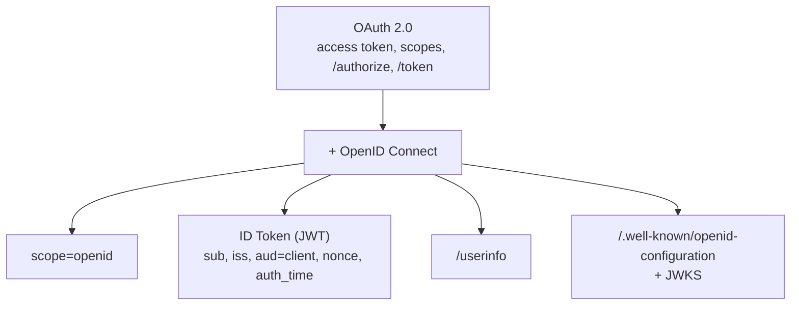

### BFF login flow (confidential client)

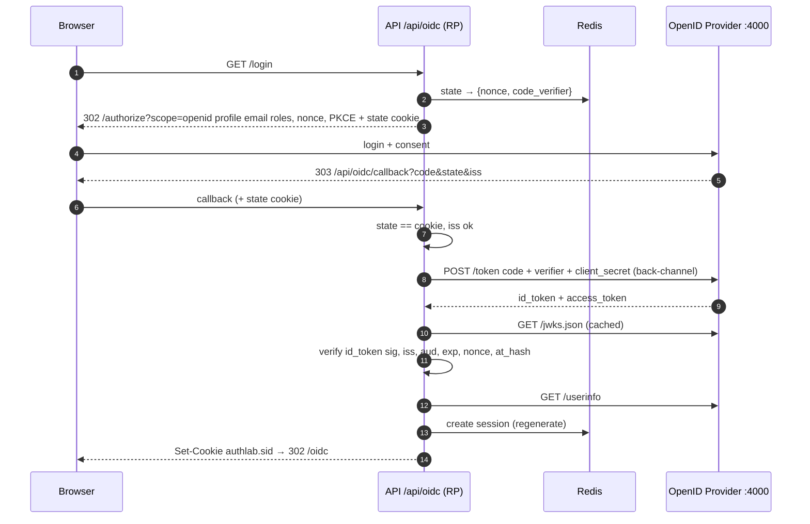

**Standard practices implemented**

- ✅ Validate ID token: signature (JWKS), iss, aud, exp, nonce
- ✅ state bound to browser cookie
- ✅ BFF keeps tokens out of the browser
- ✅ Use discovery instead of hard-coding endpoints
- ✅ PKCE even for confidential clients

**Pitfalls**

- ⚠️ Using an access token as identity proof
- ⚠️ Skipping nonce → replay
- ⚠️ Sending ID token to APIs (it is for the client, aud = client_id)

```bash
curl localhost:4000/.well-known/openid-configuration | jq
```

<a id="saml"></a>
## 9. SAML 2.0

**Kind:** Identity protocol · **Answers:** Authentication, Federation / SSO · **Stateful** · **API:** `/api/saml`

SAML 2.0 is the XML-based enterprise SSO protocol. The Service Provider redirects the user to the Identity Provider; the IdP authenticates and returns a digitally-signed XML Assertion through the browser (HTTP-POST binding). Trust is set up by exchanging metadata (entityID, URLs, X.509 cert).

| Credential travels as | Best for | Avoid when |
|---|---|---|
| `Signed XML <Assertion> POSTed by the browser to the SP ACS URL` | Enterprise SSO (ADFS, Okta, PingFederate) with legacy apps | Mobile/native apps, new greenfield systems |

### SP-initiated SSO

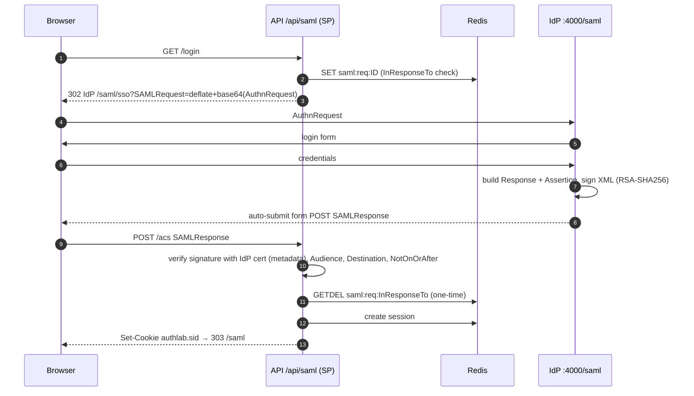

### Assertion anatomy

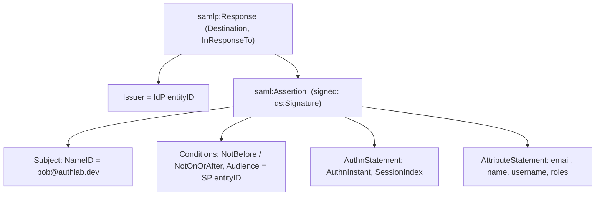

**Standard practices implemented**

- ✅ Require signed assertions; verify with cert from metadata
- ✅ Validate Audience, Destination, time window, InResponseTo
- ✅ One-time request ids (replay protection)
- ✅ Schema validation (XML signature wrapping defence)
- ✅ Prefer SP-initiated flows

**Pitfalls**

- ⚠️ XML Signature Wrapping attacks if you hand-roll parsing
- ⚠️ Clock skew
- ⚠️ Heavy, browser-only (poor for mobile/APIs)
- ⚠️ Certificate rotation coordination

```bash
curl localhost:3333/api/saml/metadata   # SP metadata
curl localhost:4000/saml/metadata       # IdP metadata
```
